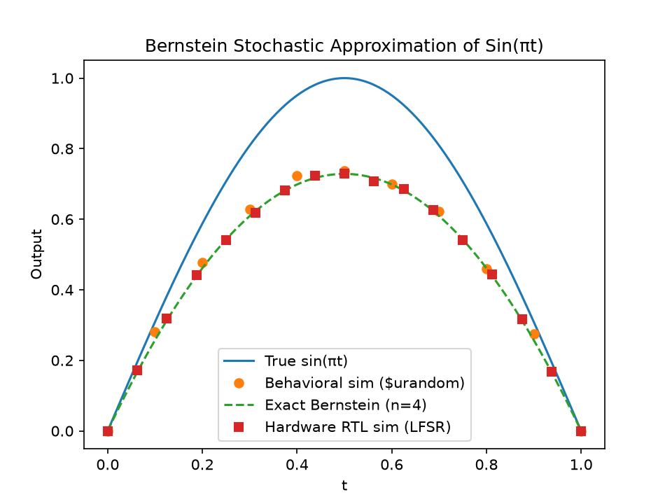
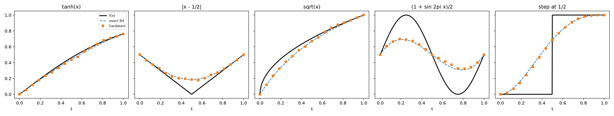
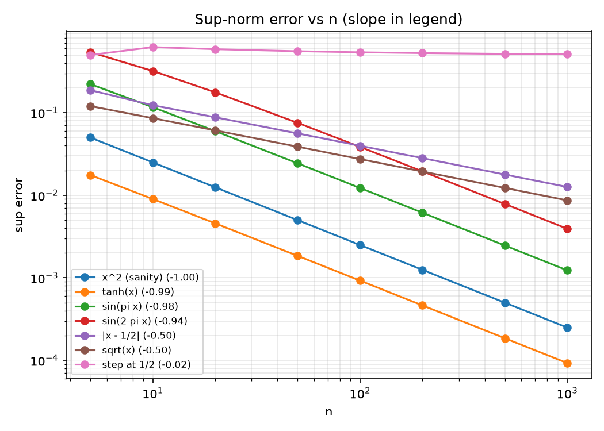

# Stochastic Bernstein Polynomials in SystemVerilog

A synthesizable stochastic-computing circuit that evaluates Bernstein polynomials using LFSRs, comparators, an adder and a MUX, targeting the Nexys A7-100T FPGA. Based on Qian & Riedel, *The Synthesis of Robust Polynomial Arithmetic with Stochastic Logic* (DAC 2008). 
Done as a CSE 320 honors contract at Arizona State University, Fall 2026.



## Results

- **Hardware (RTL, n = 4, N = 1024 cycles):** matches the exact Bernstein value for sin(πt) to within 0.01 across a 17-point sweep (747/1024 = 0.7295 against 0.7285 at t = 0.5).
- **Five more functions on the same circuit**, changing only the five coefficient thresholds:

| Function | B0 to B4 (× 1/1024) | Circuit vs exact B₄ | Exact B₄ vs f |
|---|---|---|---|
| tanh(x) | 0, 251, 473, 650, 780 | 0.025 | 0.022 |
| \|x − ½\| | 512, 256, 0, 256, 512 | 0.015 | 0.19 |
| √x | 0, 512, 724, 887, 1024 | 0.025 | 0.13 |
| (1 + sin 2πx)/2 | 512, 1024, 512, 0, 512 | 0.034 | 0.31 |
| step at ½ | 0, 0, 1024, 1024, 1024 | 0.022 | 0.59 |



- **Convergence study (Python, n = 5 to 1000):** error falls like 1/n for smooth functions, 1/√n at a sharp corner or infinite slope, and does not improve at a jump.



The full write-up is in [`docs/report.pdf`](docs/report.pdf).

## How it works

Each value in [0, 1] is a bit stream that is 1 with that probability. Four input streams at probability t are added to give `sel` (0 to 4), and `sel` picks one of five coefficient streams through a MUX. The output is 1 with probability

Bₙf(t) = Σ bᵢ · C(n, i) · tⁱ · (1 − t)ⁿ⁻ⁱ

and a counter averages it over 1024 cycles. Each stream comes from a stochastic number generator: a 10-bit maximal-length LFSR plus a comparator.

## Repository layout

```
RTL/            lfsr.sv, sng.sv, bernstein_top.sv, board_top.sv (Nexys A7 wrapper)
SIM/            testbenches (Icarus Verilog), including the behavioral model
constraints/    nexys_a7.xdc
scripts/        bernstein_study.py, plot_sin.py, plot_hw.py
results/        CSV output from the simulations
plots/          figures
docs/           report
```

## Running it

Requires Icarus Verilog 12 and Python 3 with NumPy, SciPy and Matplotlib. Run everything from the repository root.

```
# RTL sweep for sin(πt) -> results/rtl_sin.csv
iverilog -g2012 -o top.vvp RTL/lfsr.sv RTL/sng.sv RTL/bernstein_top.sv SIM/bernstein_top_tb.sv
vvp top.vvp

# any function: pass B0..B4 as parameters (example: tanh)
iverilog -g2012 -s func_tb "-Pfunc_tb.B0=0" "-Pfunc_tb.B1=251" "-Pfunc_tb.B2=473" "-Pfunc_tb.B3=650" "-Pfunc_tb.B4=780" -o func.vvp RTL/lfsr.sv RTL/sng.sv RTL/bernstein_top.sv SIM/func_tb.sv
vvp func.vvp        # writes hw_func.csv; move it to results/rtl_functions/<name>.csv

# plots
python scripts/plot_sin.py
python scripts/plot_hw.py
python scripts/bernstein_study.py
```

## Status

Verified in simulation. The board wrapper and constraints are written; the FPGA run on the Nexys A7 is next.

## Tools

Icarus Verilog 12, Python 3.13 (NumPy, SciPy, Matplotlib). Claude Opus 5.5 (Anthropic) helped explain the paper, debug, and draft parts of the documentation.